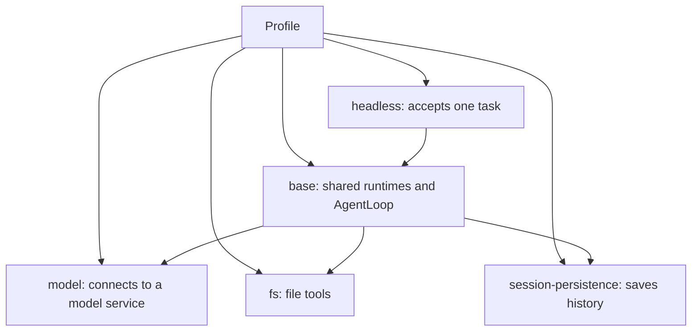

# Builtin application concepts

English | [中文](concepts.zh.md)

This page uses the [coding-agent Profile](../examples/coding-agent/profile.yaml) to explain builtin components. Follow [getting started](getting-started.md) for a first build and run, and the [Profile reference](../../kernel/docs/profiles.md) for YAML changes.

## 1. How a task executes

The Profile selects shared services, a model provider and a task consumer. Coding-agent also adds file tools and history storage:

`base` introduces six foundational service instances, but no model provider or consumer. `model` registers a model; `headless` selects it and accepts a task. After the whole graph is ready, headless creates an Agent and Session. AgentLoop calls the model, executes requested tools and returns their results. The invocation prints its answer, releases runtime resources and exits.

The Profile's `model` is a plugin instance; an Agent executes tasks. Each headless invocation handles one task. Later invocations can resume the same Session history.

## 2. Distinguish configuration names

| Name | Example | Purpose |
| --- | --- | --- |
| Plugin type ID | `qi/llm/openai-compatible` | `plugin` selects the implementation. |
| Plugin instance ID | `model` | `id` names the instance for configuration overrides. |
| Product model ID | `coding-model` | Shared by the provider's `catalog[].id` and headless `config.model`. |
| Vendor model name | `your-model` | The provider's `catalog[].model` names a model supported by the service. |

When changing the vendor model, you can usually update the catalog's `model` while keeping `coding-model`. Renaming a plugin instance does not change the product model ID. See [OpenAI-compatible](../llm/openai/README.md) for fields and model service setup.

## 3. Compile capabilities and enable instances

`builtin/bundle.Extension()` reuses kernel's six foundational types and `base`, then adds four concrete implementations, yielding ten available types:

| Source | Capability | Profile selection |
| --- | --- | --- |
| Kernel | Events, Session, LLM, Prompt, Tool and AgentLoop | `bundles: [base]` introduces six foundational instances. |
| Builtin | `qi/llm/openai-compatible` | Declare a model provider with endpoint/catalog. |
| Builtin | `qi/session/persistence-jsonl` | Declare persistence with a directory. |
| Builtin | `qi/tools/fs` | Declare file tools. |
| Builtin | `qi/cli/headless` | Declare a task consumer and select a product model. |

Compiling a type does not create instances; the Profile selects the runtime graph. Configuration changes among these instances need no rebuild. For a new Go plugin, select its Extension with `qi-build --with` and rebuild. Ordinary Go dependencies do not register plugins automatically. See [kernel building](../../kernel/docs/building.md) for commands.

## 4. Where files and Sessions are stored

`fs` registers `read_file` and `write_file` in Tool Runtime. The model decides whether to request them; AgentLoop executes the calls. Relative paths resolve from Session cwd. This is a path base; filesystem access uses the host's permissions. See [file tools](../tools/fs/README.md) for read/write behavior.

`session-persistence` saves history as JSONL. History remains after headless exits and can be continued with `--session-id`. The storage directory resolves from process cwd. Keep the original working and storage directories when resuming. Neither uses the Profile directory as its base; see [JSONL](../session/jsonl/README.md).

See [Headless](../cli/headless/README.md) for output, JSON events and normal turn completion. Generated file contents and test results still need direct verification; practice this in the [coding agent](../examples/coding-agent/README.md).

## 5. Continue learning

- Generate code and continue a Session with builtin components: [coding-agent](../examples/coding-agent/README.md).
- Implement and register a tool: [tool-plugin](../examples/tool-plugin/README.md).
- Run that tool in a child process: [tool-process](../examples/tool-process/README.md).

For general execution objects, read [kernel core concepts](../../kernel/docs/concepts.md). For call flows and resource ownership, read [kernel architecture](../../kernel/docs/architecture.md).
