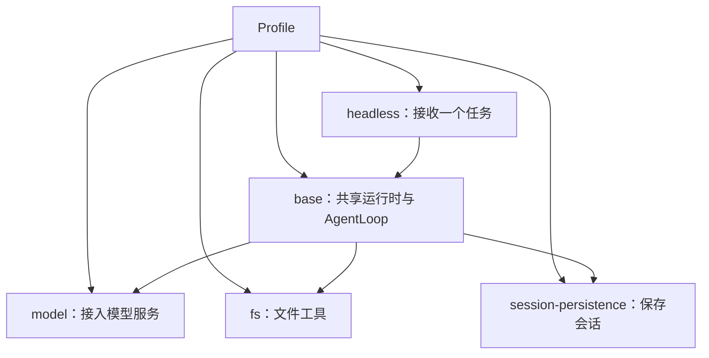

# 内建应用概念

[English](concepts.md) | 中文

本页用 [coding-agent Profile](../examples/coding-agent/profile.yaml) 解释内建组件的关系。首次构建和运行见[入门](getting-started.zh.md)；如何修改 YAML 见 [Profile 配置参考](../../kernel/docs/profiles.zh.md)。

## 1. 一个任务如何执行

Profile 选择共享服务、模型提供者和任务消费者；coding-agent 还加入文件工具与历史存储：

`base` 引入六个基础服务实例，但不包含模型提供者或消费者。`model` 注册模型，`headless` 选择它并接收任务。全图就绪后，headless 创建 Agent 和 Session，AgentLoop 调用模型；模型请求工具时，由 Loop 执行并交回结果，最后输出本次回答、释放运行资源并退出。

Profile 中的 `model` 是插件实例；Agent 是执行任务的对象。一次 headless 调用处理一个任务，后续调用可以恢复同一个 Session 的历史。

## 2. 区分配置中的名称

| 名称 | 示例 | 用途 |
| --- | --- | --- |
| 插件类型 ID | `qi/llm/openai-compatible` | `plugin` 选择实现。 |
| 插件实例 ID | `model` | `id` 命名实例，供覆盖配置使用。 |
| 产品模型 ID | `coding-model` | 提供者 `catalog[].id` 与 headless `config.model` 使用同一 ID。 |
| 供应商模型名 | `your-model` | 提供者 `catalog[].model` 指定模型服务支持的名称。 |

因此，修改供应商模型时，通常只需要调整 catalog 中的 `model`，可以保留 `coding-model`。重命名插件实例也不会改变产品模型 ID。字段含义和模型服务配置见 [OpenAI-compatible](../llm/openai/README.zh.md)。

## 3. 编译能力与启用实例

`builtin/bundle.Extension()` 复用 kernel 的六种基础类型和 `base`，再加入四种具体实现，共十种可用类型：

| 来源 | 能力 | Profile 如何使用 |
| --- | --- | --- |
| kernel | events、Session、LLM、Prompt、Tool、AgentLoop | `bundles: [base]` 引入六个基础实例。 |
| builtin | `qi/llm/openai-compatible` | 声明模型提供者并配置 endpoint/catalog。 |
| builtin | `qi/session/persistence-jsonl` | 声明持久化提供者并配置 directory。 |
| builtin | `qi/tools/fs` | 声明文件工具实例。 |
| builtin | `qi/cli/headless` | 声明任务消费者并选择产品模型。 |

编入类型不会自动创建实例；Profile 决定哪些实例参与本次运行。调整这些实例的配置无需重建。新增 Go 插件时，用 `qi-build --with` 选择其 Extension 并重新构建；普通 Go 依赖不会自动注册插件。构建步骤见[kernel 构建指南](../../kernel/docs/building.zh.md)。

## 4. 文件与会话保存在什么地方

`fs` 向 Tool Runtime 注册 `read_file` 和 `write_file`。模型决定是否请求这些工具，AgentLoop 执行调用。相对路径按 Session 工作目录解析；这是路径基准，文件访问仍使用宿主权限。读写行为见[文件工具](../tools/fs/README.zh.md)。

`session-persistence` 将会话历史保存到 JSONL。headless 退出后历史保留，后续调用通过 `--session-id` 继续。存储目录按进程工作目录解析；恢复时保持原工作目录和存储目录。它们都不以 Profile 所在目录为基准，详见 [JSONL](../session/jsonl/README.zh.md)。

输出、JSON 事件及本轮是否正常完成的判断统一见 [Headless](../cli/headless/README.zh.md)。生成文件的内容与测试结果仍需实际检查，练习见[编码智能体](../examples/coding-agent/README.zh.md)。

## 5. 继续学习

- 使用内建组件生成代码并继续会话：[coding-agent](../examples/coding-agent/README.zh.md)。
- 编写并注册工具：[tool-plugin](../examples/tool-plugin/README.zh.md)。
- 将工具交给独立子进程：[tool-process](../examples/tool-process/README.zh.md)。

通用对象与执行资源的关系见 [kernel 核心概念](../../kernel/docs/concepts.zh.md)；调用流程和资源所有权见[kernel 架构](../../kernel/docs/architecture.zh.md)。
