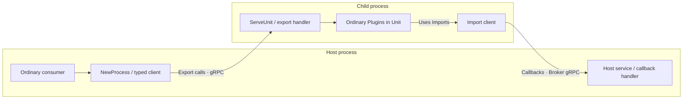

# Architecture and lifecycle

English | [中文](architecture.zh.md) · [README](../README.md)

gordis-rpc runs a Gordis assembly in a child process and connects services through explicit Bindings. Business objects, Scopes and Go functions stay in their own processes; DTOs cross the boundary.

## Responsibilities

| Layer | Owns |
| --- | --- |
| Ordinary Gordis Plugin | Spec/Activate, Get/Provide, business configuration and cleanup |
| Domain adapter / Binding | DTOs, serialization, typed clients, method handlers and domain contributions |
| gordis-rpc | Unit assembly, boundary checks, Session, readiness and cleanup coordination |
| go-plugin / gRPC | Process startup, base handshake, connections, Broker and RPC transport |

The runtime imports neither Qi nor legacy `gordis/process` or `processbridge`. Tool, model and prompt rules belong to their domain adapters. Programs are trusted and local; process isolation is not an untrusted-code sandbox.

## Startup: business readiness follows process startup

1. **Declare:** the Host registers `NewProcess(ProcessOptions)`; the child declares Identity and Unit through `ServeUnit`.
2. **Resolve dependencies:** activation resolves Imports through Host Scope.Get, registers teardown, then starts the program. StartupTimeout begins before import validation.
3. **Discover and check:** Describe returns identity and the complete Boundary. The Host checks identity constraints and contract names, versions and directions before constructing or activating business instances.
4. **Initialize:** Imports require a Broker callback server. Initialize sends Session and business configuration. The child assembles its local instances through a Gordis ChangeSet, waits for Ready, then resolves, validates and fixes exports.
5. **Publish and watch:** `NewProcess` constructs and checks all export clients once, then publishes those same instances through Scope.Provide. Attach runs optional Accept after remote Ready and installs a Scope-owned Watch.

Initialization, client preparation, publication or Accept failures trigger idempotent cleanup before returning; Gordis rolls back staged Scope services. An established connection or live PID does not establish business readiness.

## Choosing an entry point

For ordinary services, use `NewProcess` to handle Requires/Provides and proxy publication. Use `Attach(ctx, scope, options)` and Accept directly for domain contribution registration or similar adapter logic.

A Plugin using Attach directly must include `RequiredServices(boundary.Imports)` in Requires. Attach resolves dependencies from Scope, preserving callback provider lifetimes; it does not accept arbitrary Host service objects. It does not publish Exports automatically: obtain proxies with `ExportClient(session, key)`, then explicitly Provide them or register domain contributions.

## Calls and cancellation

Each Attach generates a random Session ID tied to the Host instance and generation. An Invoker is restricted to one contract and Session; ExportClient accepts only declared exports with a matching Go type.

Export requests hold a Scope Ready lease, preventing service release while the call is active. Cancellation reaches the handler; the lease is released only when the actual handler returns. Server streams send chunks synchronously without a runtime production queue. Stopping consumption cancels the remote stream. Domain layers own business concurrency budgets.

The protocol is `gordis-rpc/1`. Control messages and domain DTOs use JSON carried by protobuf BytesValue over gRPC unary/server-stream calls. Wire Go types and RPC paths are private. See [Bindings](bindings.md) for the generated payload format.

## Shutdown and failure

Normal shutdown proceeds through **Quiesce to close admission and initiate child Shutdown → Dispose to await the cleanup report → Host process reaping → Host callback server shutdown**. The callback server waits for actual handler exit, keeping dependency providers alive until callbacks finish.

Watch reports child node failures and unexpected termination to the Host. If the main connection closes or parent identity changes, the child attempts cleanup and stops serving within OrphanGrace, allowing the standard main to return. Parent checks also cover startup before Initialize. Uncooperative business code or callbacks can leave cleanup incomplete.

`Session.Snapshot()` and `ProcessPlugin.Snapshot()` return independent diagnostic copies:

| Field | Meaning |
| --- | --- |
| Ready | Remote readiness was reached; cleared on normal reaping, not a live health check |
| Nodes | Initialization-time snapshots, not continuously updated node state |
| Reaped | The process was reaped; this does not prove business cleanup |
| Cleanup | Inspect CleanupComplete, Forced and Errors for actual cleanup results |

ProcessPlugin retains failed-Attach diagnostics and returns a zero value before Attach. Source entry points: [process.go](../process.go), [session.go](../session.go), [unit.go](../unit.go), [server.go](../server.go).
