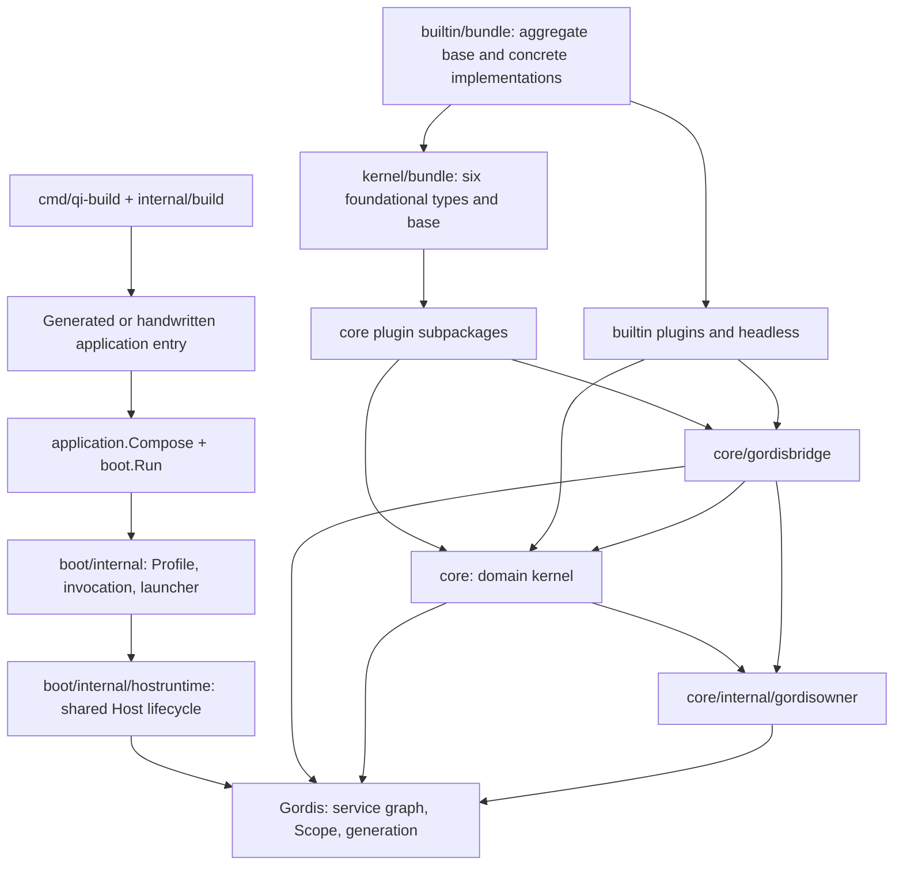
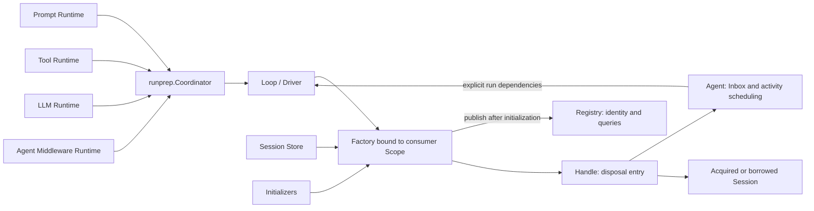
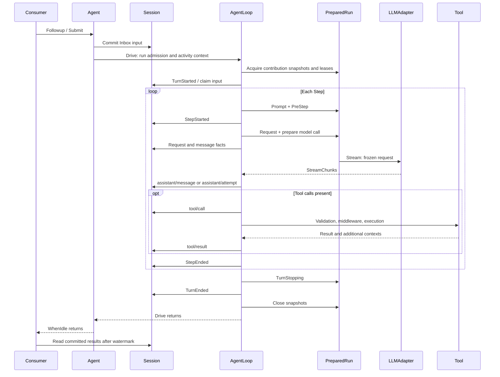
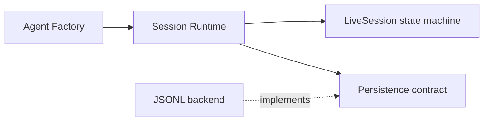

# Qi architecture

English | [中文](architecture.zh.md)

Qi's capability packages own business types, Runtimes, service Keys and Scope Bindings. Their public APIs depend on Gordis for service identity and generation ownership. Business execution remains separate from concrete model, storage and interaction implementations. The application layer turns explicit Extensions and a Profile into one shared Host. At build time, `qi-build` generates that application's entrypoint.

This guide explains kernel layers, execution, consistency and resource ownership, using builtin to show concrete integrations. Read [Core concepts](concepts.md) for object definitions, [Building](building.md) for extension builds and [builtin getting started](../../builtin/docs/getting-started.md) for a first run and concrete configuration.

## 1. Layers and dependency direction

Arrows show entry calls or code dependencies; the Host performs actual plugin mounting. Public domain definitions and implementations belong to [core](../core/README.md). Public application and bridge definitions now belong to boot and core/gordisbridge; private startup now belongs to boot/internal.

| Location | Responsibility | Dependency boundary |
| --- | --- | --- |
| `core` domain packages | Protocol, Session, Agent, Loop, LLM/Prompt/Tool, middleware, registry and run preparation. | Tools/LLM/Prompt/middleware/Session/Agent directly use Gordis; Loop/runprep use it transitively. No boot, bridge or concrete plugin imports. |
| `core/gordisbridge` | Low-level ScopeOwner, Factory lifecycle implementation, observation Topics and event adaptation. | Connects core contracts to Gordis lifecycles. |
| `boot/internal/hostruntime` | Shared Host creation, mounting, startup rollback and shutdown. | No model, tool or headless policy. |
| `core/<capability>/plugin` | Wraps kernel implementations as service providers. | Creates and publishes shared resources in Scopes and registers cleanup. |
| `builtin/llm/openai` | Builtin Chat Completions HTTP/SSE adapter and explicit compatibility settings. | Uses llm types and transitively depends on Gordis; only its `plugin` subpackage directly uses framework APIs. |
| `builtin/cli/headless` | Task parsing, persistent resume, committed output and completion policy. | Uses the original Host's Factory through public core/boot APIs. |
| `boot/internal` | Registration catalog, Bundle/Profile composition, preflight, invocation admission, Ready gate and process control. | Runtime execution does not depend on the builder. |
| `bundle` | Six foundational types, events registration and the sole base definition. | No builtin dependency. |
| `builtin/bundle` | Reuses kernel bundle and adds four concrete implementations, yielding ten types. | Uses public kernel APIs; publishes metadata without mounting instances. |
| `boot/{application,profile,registration,launch}` | Pure composition and canonical public integration metadata/contracts. | Private startup belongs to `boot/internal`. |
| `internal/build` | Go source/version resolution, entry generation, compilation and build records. | Toolchain code outside Agent execution. |
| Local `*_test.go` and `testdata` | Behavior tests and necessary file/program fixtures. | Each package and module owns its verification. |

Contracts, protocol, modelcatalog and private registry/observation production closures remain free of capabilities, Gordis and startup layers. Business implementations may use capability types and depend on Gordis transitively, but cannot directly import framework APIs or depend on boot, bridge or plugins. Scope owner adaptation only depends on Gordis and contracts. Each type has one canonical public owner; core tests keep helpers and case data in local `_test.go` files.

## 2. From application description to Ready

An entry performs two steps: `application.Compose(...)` creates a static Application; `boot.Run(argv, input, application)` launches an explicit Profile.

1. **Describe capabilities.** Extension factories return registrations, configuration schemas and Bundle definitions. Compose validates type IDs, descriptors and schemas and freezes Bundle definitions. It does not read credentials, open storage, listen on ports or start a Host.
2. **Parse and compose the Profile.** Expand Bundles, then apply user instances and overrides. All declarations, including disabled ones, must reference public types. Only active instances enter configuration and dependency preflight.
3. **Build a candidate plan.** Derive Requires/Provides from plugin Specs, validate configuration, compatibility, model descriptions and dependencies, and produce a dependency-ordered MountPlan. At most one CLI argument consumer and one completion owner are permitted; these permissions are declared separately.
4. **Prepare the invocation.** The selected consumer owns Parser/Prepare/Bind, parses application arguments and produces Prepared state. The launcher supplies streams, parent context and Ready/claim/completion coordination.
5. **Mount the shared Host.** Mount the launch-context carrier first, then MountReady each planned instance. Plugins provide services and register contributions in Activate. Startup or Ready-check failures use the same Host rollback path.
6. **Open whole-graph Ready.** After mounts, checks and startup hooks succeed, the launcher opens invocation admission. Finite consumers can then claim and execute. Instance Ready and whole-graph invocation Ready are separate gates.

A graph without a completion owner remains resident until its parent context is canceled. A graph without an argument consumer does not have headless read stdin or take over application arguments. The launcher requires `--profile` and selects no default Profile. Applications or deployment environments prepare credentials.

Sources: [Compose](../boot/application/application.go), [Profile composition](../boot/internal/profile/compose.go), [candidate planning](../boot/internal/registration/candidate.go), [CLI](../boot/internal/cli/cli.go) and [launcher](../boot/internal/launcher/runtime.go).

## 3. How shared services assemble an Agent

Base's events, Store, LLM, Prompt and Tool services support `qi/agent-loop`. The plugin creates the middleware Runtime, Loop, Registry, Initializers, AgentEvents and Factory provider, publishing separate query, initialization, passive observation and creation capabilities.

The Agent ID equals SessionID; `AgentOptions.ID` creates no query alias, while `InstanceID` distinguishes Agent lifetimes on the same Session. Registry holds exact identity reservations and queries published objects; it does not create Agents, own workers or dispose Handles. Factory acquires the Session and exclusive attachment, resolves configuration, initializes the Agent, records ownership and publishes it. Expensive work happens outside the Registry lock. Agent directly holds Driver, Session, Inbox and attachment-level RequestState. Loop receives these explicit dependencies and never looks up or opens a Session.

`scope.Get(agent.FactoryKey)` → `provider.Bind(scope)` binds Factory to the exact caller and provider generations. Publication uses both the Factory shutdown gate and generation leases: initializing objects remain hidden, and a stop race either delivers an owned Handle or rolls the transaction back. Caller stop drains its Factory; provider stop coordinates all factories. Shared observation and middleware close after resource drain. Creation contexts govern transactions; cancelling one after delivery does not stop the Handle.

Create requires `ResourceStore` for exact creation rollback and Release. Resume also requires `StoreOpener` to acquire runtime resources from existing history. Prefer passing a Session object to Attach; the compatible ID lookup only borrows an already opened instance. Without owned capabilities, an explicit `AttachOnly` Factory rejects Create/Resume and an outer owner acquires the Session before lending it. See [Agent plugin](../core/agentloop/plugin/plugin.go), [Factory](../core/agent/factory.go), [Handle](../core/agent/handle.go) and [Scope bridge](../core/gordisbridge/factory.go).

Handle.Dispose stops admission, cancels and drains settlement, then releases attachment, configuration and owned Session runtime resources. Normal disposal preserves history; Attach never releases the borrowed Session. Dispose is idempotent with one shared cleanup result. A wait timeout only ends the wait; disposal continues in the background. Direct `agent.NewFactory` callers own Close.

## 4. Execution path for one input

Built-in headless uses `Followup`; general callers can also use `Submit`, which returns an observation stream. Both enter the same Agent input scheduler and Loop.

This shows the principal path. Errors and rejection enter their settlement branches. Snapshots close when Drive exits.

### Run preparation and steps

Coordinator acquires Prompt, Tool, LLM and Agent middleware snapshots in order. Later acquisition failure releases earlier snapshots in reverse order. It retains separate registry revisions, rather than one atomic snapshot across registries. Nil Selection slices select all entries; non-nil empty slices select none. Tool middleware remains in the tool snapshot regardless of Tool selection.

Each Step claims input, assembles Prompt and applies PreStep. Rejected candidates are not admitted as model messages. After Request middleware transforms call configuration, LLM Runtime selects an Adapter, merges defaults and prepares the call. request/header, request/context and Surface messages record admitted facts. The final LLMRequest is constructed from the committed projection and copied, preventing Adapter changes to history state.

The model stream passes through Stream middleware and accumulator validation. A successful attempt commits assistant/message; failed attempts retain stream records. RequestError middleware can return retry to start another attempt in the same Step without claiming input or applying PreStep again. The relevant implementation owns waiting, backoff and retry policy.

Tools execute in model-response order using schemas and implementations from the run snapshot. Identity validation in Pre/Execute/Post middleware prevents attribution or call ID/name changes. A Tool can add user contexts for next-step processing or indicate completion with ConcludesTurn. Pending next-step input can still continue the Loop.

Sources: [Loop](../core/agentloop/loop.go), [attempt retries](../core/agentloop/request_attempts.go), [request admission](../core/agentloop/request.go), [PreparedRun](../core/runprep/prepared.go) and [Tool Runtime](../core/tools/runtime.go).

### Execution files and state lifetimes

[Drive](../core/agentloop/loop.go) validates explicit dependencies and acquires run admission. [Turn](../core/agentloop/turn.go) acquires PreparedRun, starts the turn, sequences steps and settles it. [Step preparation](../core/agentloop/step.go) claims input once and applies Prompt/PreStep; [attempts](../core/agentloop/request_attempts.go) retry within that Step. [Tool execution](../core/agentloop/tool.go) preserves proposal/result order and drains after cancellation. [Settlement](../core/agentloop/settle.go) retains original causes and commits Step/Turn endings. Both run admission and PreparedRun release through defer.

RequestState, attempt IDs and stream revisions belong to the attachment and continue across Turns. InstanceID distinguishes counter resets after Agent replacement. PreparedRun holds the same contribution generation lease for schema and dispatch until execution finishes.

## 5. Session consistency and recovery

Under one mutex, Session append normalizes the protocol, validates state transitions and prepares the incremental projection, then calls the storage commit hook. Only successful commit publishes the log and new projection. Observation follows outside the lock. A Store backend must commit one complete encoded event or leave its storage prefix unchanged.

Fold provides independent pure reconstruction. The incremental cache reduces repeated history reads and returns detached snapshots. Surface replacements retain old log facts while changing messages visible to later model requests. RequestState belongs to one attachment and retains request-series state across its Turns.

Restore validates consecutive sequences, legal state and the complete projection without repairing storage. The storage owner retains exclusive ownership until recovery and publication finish. Session.Attach commits the closers needed for interrupted steps, tools and turns before admitting work. Backends own physical loading, file-tail repair and persistent resource release; core supplies the shared state machine.

Runtime owns the sole running Session table and implements Store, ResourceStore and StoreOpener. Each acquisition resolves one persistence lease and retains its original backend and handle; the backend tracks only physical history handles. `Get` never loads disk. `Open` obtains exclusive ownership, reads committed history, applies the entry HeaderCheck and domain validation, then prepares the physical tail. Attach performs logical repair and Factory initializes before publication. JSONL errors are reported on opening the selected history, so unrelated corrupt histories do not prevent startup.

Drain Factory/Handles first, then Runtime instances, handles and leases. The resource owner closes the physical backend and releases its directory lock after the last reference; the backend Scope may clean up first without waiting for Runtime. Release preserves history; Delete removes it. Failed cleanup retains precise ownership and can be retried. Business admission opens only after the whole composition is Ready. Acquisition uses Lookup followed by the provider's Acquire; errors propagate. Profiles explicitly select a provider; preflight rejects conflicting providers. Without a selected provider, new Sessions use memory and Resume is unsupported.

Sources: [Session](../core/session/session.go), [storage recovery API](../core/session/storage.go), [incremental projection](../core/session/incremental.go) and [pure projection](../core/session/projection.go).

## 6. Cancellation, settlement and shutdown

Canceling activity context stops new model and tool work. The Loop uses a settlement context derived with `context.WithoutCancel` to record admitted work: committed tool calls still need ordered results, and started tools must drain before Step/Turn closure. If storage rejects settlement, local observations can report an uncommitted failure. A live ended notification does not prove a successful log append.

| Owner | Releases | Borrows or preserves |
| --- | --- | --- |
| launcher / Host | Whole-graph startup rollback, consumer drain and shared Host shutdown. | Credentials prepared by application/deployment. |
| Service provider Scope | Its Store, Runtime, Factory provider and cleanup hooks. | Dependency services. |
| Contribution plugin Scope | Exact registrations; its transports and other resources after lease drain. | Shared Runtime. |
| Caller Scope / Factory | Creation transactions and successful Handles. | Shared Store, Registry and Driver. |
| Session Runtime | Running instances, exact persistence handles and resource leases. | Shared Persistence backend and retained history. |
| Persistence provider | Plugin reference, independent leases, shared backend and directory writer lock until final release. | Domain Session state. |
| Handle | Agent activity, attachment and owned Session runtime resources. | Persistent history and the Session borrowed through Attach. |
| PreparedRun / PreparedStep | Bound calls and contribution leases. | Runtimes and plugin objects. |

ScopeOwner adapts `AcquireReady` / `OnStop` to core's ContributionOwner contract. Withdrawal affects future selection; existing snapshots retain the exact generation. Runtimes and plugins must honor that drain boundary rather than closing a transport still in use when its registration disappears.

Finite consumers use `boot/launch.Task` to wait for Ready, claim once and report completion. They call `begin` before cleanup to start the process shutdown deadline. The launcher drains the invocation before closing the shared Host. The supervisor currently allows a default five-second cleanup window; a second signal or timeout can force exit. Forced exit does not prove drain or durable settlement. Handle/Factory wait-context expiration ends only that wait; background disposal continues.

Sources: [settlement](../core/agentloop/settle.go), [Task](../boot/launch/task.go), [launcher shutdown](../boot/internal/launcher/runtime.go), [Host shutdown](../boot/internal/hostruntime/runtime.go) and [process control](../boot/internal/processcontrol/shutdown.go).

## 7. Extension seams

Extension factories describe capabilities. Plugin.Activate obtains services and registers contributions. Execution callbacks implement behavior. Keep these three stages' responsibilities separate.

| Capability to add | Integration seam | Owner |
| --- | --- | --- |
| Model | Require `llm.RuntimeKey`; `runtime.Bind(scope).RegisterAdapter`, or `RegisterProvider` for a static catalog. | Model plugin Scope. |
| Prompt | Require `prompt.RuntimeKey`; `runtime.Bind(scope).Register(prompt.Section)` with ID/Order. | Prompt plugin Scope generation. |
| Tool | Require `tools.RuntimeKey`; `runtime.Bind(scope).Register` / `RegisterBatch` with `tools.Definition`. | Tool plugin Scope generation. |
| Agent behavior | Require `agentmiddleware.RuntimeKey`; `runtime.Bind(scope).Register(agentmiddleware.Middleware)`. | Behavior plugin Scope generation. |
| Tool behavior | `runtime.Bind(scope).RegisterMiddleware(tools.Middleware)`. | Behavior plugin Scope generation. |
| Passive observation | Gordis events subscriptions to public SDK Session/assistant-stream Topics. Submit callers can also read the returned observation stream. | Observer Scope; Topic subscriptions withdraw with it. |
| Consumer | Require `agent.FactoryKey`; get the Provider and call `provider.Bind(scope)`; own input, output, model selection and exit policy. | Consumer Scope. |
| Persistence backend | Implement `session.Persistence` / `PersistenceHandle`; publish `session.PersistenceKey` through a `PersistenceProvider`, reusing core Runtime and recovery. | Provider owns backend; independent acquisition leases protect history handles. |
| Custom Session service | Implement Store when replacing domain instance management; owned Create also requires ResourceStore, and Resume requires StoreOpener. | Custom service owner. |

A new disk or database backend normally implements Persistence rather than replacing Store. During business acquisition, `qi/session` discovers the provider with Lookup and calls Acquire. Each lease fixes its backend and may be released only after acquired history handles close or roll back. Distinguish normal absence from acquisition errors; errors must not fall back to memory. See [Session APIs](../core/session/README.md) and [persistence.go](../core/session/persistence.go).

`llm.Binding.RegisterProvider` rolls back its Adapter registration if catalog registration fails. It does not publish atomically across both registries. Direct provider/model selection needs no catalog.

EventDispatcher uses a generation-owned worker to drain a bounded queue. Producers do not wait for passive observers; Dropped exposes overload. Initialize is a fallible control interface that can register rollback; ordinary operations stay closed during initialization. Created records publication before run observations; Disposed records the final snapshot and cleanup errors after activity, attachment, configuration and owned Session runtime resources are released. Passive callbacks can reenter Dispose/WhenIdle; resource disposal does not wait for them. Notifications are bounded and may drop. Reliable result consumers read committed Session facts.

See [SDK](../core/README.md), [LLM Binding](../core/llm/binding.go) and [observation dispatch](../core/gordisbridge/events.go). The [tool plugin example](../../builtin/examples/tool-plugin/README.md) demonstrates Scope contributions and extension builds; the [process tool example](../../builtin/examples/tool-process/README.md) adds process adaptation to the same tool. See [OpenAI-compatible](../../builtin/llm/openai/README.md) for a model implementation and the APIs above for observation contracts.

### Local observation and reading

Session.Subscribe covers all accepted legal SessionEvent sources, including Inbox, recovery and appends outside Driver. Agent.Subscribe covers lifecycle, status, Inbox and original errors; SubscribeAssistant carries complete live streams. Submit returns raw DriverEvent for its associated Driver execution only. Host publishes these raw facts through DriverEventTopic.

Subscribe before capturing the initial watermark/snapshot, backfill Events(after) by real seq, and close reading at a final watermark. Notifications may drop. Session seq and stream revision/index are independent. A committed stream ending refers to an actual event; abandoned endings claim no commit. InstanceID distinguishes a new Agent on the same Session. Discard unreliable previews after gaps and recover final content from the log.

## 8. Build, delivery and verification boundaries

qi-build resolves explicit module sources and versions, generates calls to builtin and selected Extensions, then calls Compose/boot.Run. The Go dependency graph determines compiled code; the Profile determines the runtime graph. The resulting binary needs neither Go nor source, while callers still supply a Profile. Profiles do not dynamically load Go code. UpdatePolicy metadata does not mean the unified CLI automatically watches or hot-reloads files.

Kernel provides the memory Store and foundational services. Builtin owns headless, OpenAI-compatible, JSONL and file/process tools. Other model protocols, storage backends, Web and distribution policies come from selected extensions/applications. Kernel does not depend on builtin or optional plugins. There is no separate public Host assembly facade; programmatic consumers bind the original Host's Factory from their Scope. Domain constructors remain available for implementations and independent tests.

| Verification location | Coverage |
| --- | --- |
| Core Go tests | Session protocol/recovery/projection, scheduling, retries, tools, cancellation and ownership. |
| [Protocol tests](../core/protocol) | Wire format round trips and invalid-input rejection using local Go test tables. |
| [Agent tests](../boot/internal/launcher/agenttest/application_test.go) | Host/SDK composition; domain requests, snapshots and Tool identity live in [core Agent tests](../core/agent). |
| [Host Factory tests](../boot/internal/launcher/agenthosttest/host_test.go) | Caller/provider stop, rollback and Handle drain. |

Tests live beside their owning packages. See the [kernel README](../README.md) and [builtin README](../../builtin/README.md) for local build and test commands. Local tests do not establish public-model, published-module or cross-platform acceptance.

## 9. Read source by question

| Question | Starting points |
| --- | --- |
| How does a type enter the application? | [application.go](../boot/application/application.go) → [registration.go](../boot/internal/registration/registration.go) |
| How does a Profile become a runtime graph? | [compose.go](../boot/internal/profile/compose.go) → [profile.go](../boot/internal/profile/profile.go) → [candidate.go](../boot/internal/registration/candidate.go) |
| Who creates and closes the Host? | [boot.Run](../boot/run.go) → [CLI](../boot/internal/cli/cli.go) → [launcher](../boot/internal/launcher/runtime.go) → [Host Runtime](../boot/internal/hostruntime/runtime.go) |
| How are Agents created and drained? | [qi/agent-loop plugin](../core/agentloop/plugin/plugin.go) → [Factory bridge](../core/gordisbridge/factory.go) → [Factory](../core/agent/factory.go) → [Agent](../core/agent/agent.go) |
| How does input reach models and tools? | [Agent](../core/agent/agent.go) → [Loop](../core/agentloop/loop.go) → [runprep](../core/runprep/prepared.go) |
| Why can history differ from live display? | [Session projection](../core/session/projection.go) → [assistant attempt](../core/agentloop/assistant_stream.go) → [stream outcome](../core/protocol/assistant_stream.go) |
| How is the application entry generated? | [cmd/qi-build](../cmd/qi-build/main.go) → [build](../internal/build/build.go) → [generate](../internal/build/generate.go) |
