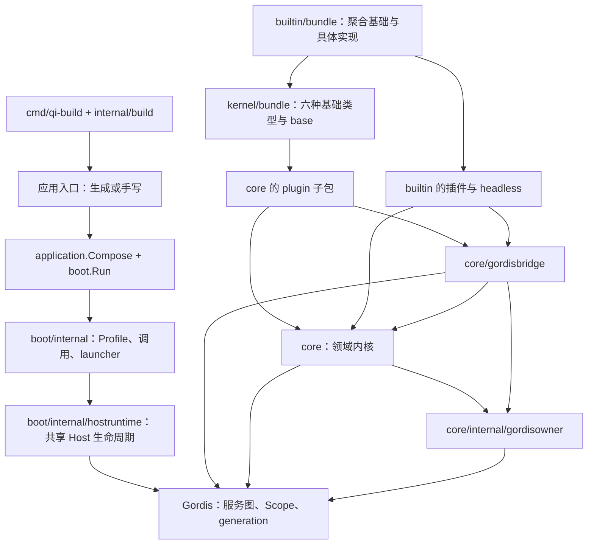
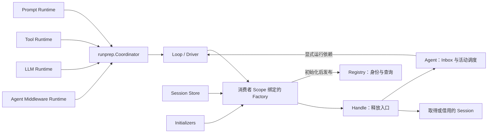
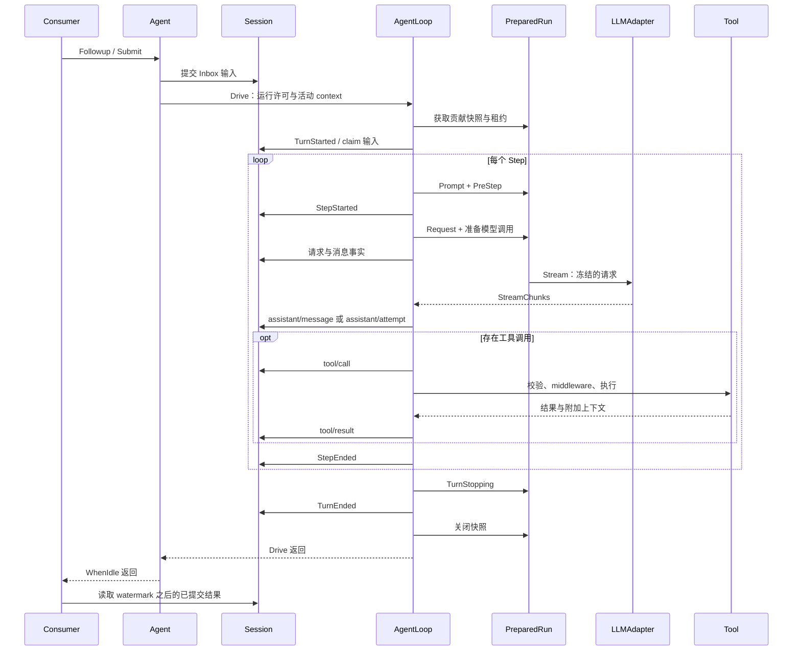
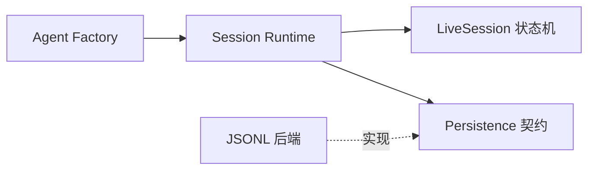

# Qi 架构

[English](architecture.md) | 中文

Qi 的能力包拥有业务类型、Runtime、服务 Key 与 Scope Binding，公开 API 通过 Gordis 管理服务身份和 generation 所有权；业务执行与具体模型、存储和交互实现仍保持分工。应用层将显式 Extension 和 Profile 转为一套共享 Host。`qi-build` 在构建时生成这个应用的入口。

本文解释 kernel 的分层、执行流程、一致性与资源所有权，并以 builtin 展示具体实现如何接入。对象定义见[核心概念](concepts.zh.md)，扩展构建见[构建指南](building.zh.md)，首次运行与具体配置见 [builtin 入门](../../builtin/docs/getting-started.zh.md)。

## 1. 分层与依赖方向

箭头表示入口调用或代码依赖，插件的实际挂载由 Host 完成。领域实际定义归 core，公开集成/纯组合归 boot，接桥归 core/gordisbridge。私有启动已归 boot/internal。

| 位置 | 负责什么 | 依赖边界 |
| --- | --- | --- |
| `core` 领域包 | 协议、Session、Agent、Loop、LLM/Prompt/Tool、middleware、注册表与运行准备。 | Tool/LLM/Prompt/middleware/Session/Agent 直接使用 Gordis，Loop/runprep 间接依赖；不导入 boot、bridge 或具体插件。 |
| `core/gordisbridge` | 低层 ScopeOwner、Factory 生命周期实现、观察 Topic 与事件适配。 | 连接 core 契约和 Gordis 生命周期。 |
| `boot/internal/hostruntime` | 创建、挂载、启动回滚与关闭共享 Host。 | 不承担模型、工具或对话策略。 |
| `core/<能力>/plugin` | 将内核实现包装成服务提供者。 | 在 Scope 中创建和发布共享资源，登记释放动作。 |
| `builtin/llm/openai` | 内置 Chat Completions HTTP/SSE 适配器与显式兼容配置。 | 使用 llm 类型并间接依赖 Gordis；直接框架接入归 `plugin` 子包。 |
| `builtin/cli/headless` | 任务解析、持久恢复、已提交输出与完成策略。 | 通过公开 core/boot API 使用原 Host 的 Factory。 |
| `boot/internal` | 注册目录、Bundle/Profile 组合、预检、调用准入、Ready 门与进程控制。 | 运行时不依赖构建器。 |
| `bundle` | 六种基础类型、events 注册和唯一 base 定义。 | 不依赖 builtin。 |
| `builtin/bundle` | 复用 kernel bundle 并加入四种具体实现，共十种可用类型。 | 依赖公开 kernel API；发布元数据，不挂载实例。 |
| `boot/{application,profile,registration,launch}` | 纯组合及实际公开集成元数据/契约。 | 私有启动归 `boot/internal`。 |
| `internal/build` | Go 来源/版本解析、生成入口、编译、构建记录。 | 属于工具链，不参与 Agent 执行。 |
| 本地 `*_test.go` 和 `testdata` | 功能回归与必要文件/程序夹具。 | 每个包和 module 拥有验证。 |

contracts、protocol、modelcatalog 与私有 registry/observation 的生产闭包仍不依赖能力包、Gordis 或启动层。业务实现允许通过能力类型间接依赖 Gordis，但不直接接入框架，也不依赖 boot、bridge 或具体插件。Scope owner helper 只依赖 Gordis 与 contracts。领域定义与实现直接归 [core](../core/README.zh.md)。

## 2. 应用从描述到 Ready

应用入口执行两步：`application.Compose(...)` 建立静态 Application；`boot.Run(argv, input, application)` 启动显式 Profile。

1. **描述可用能力。** Extension 工厂返回注册、配置 schema 和 Bundle 定义。Compose 检查类型 ID、描述符和 schema，冻结 Bundle 定义；不读取凭据、打开存储、监听端口或启动 Host。
2. **解析与组合 Profile。** 展开 Bundle，再应用用户实例和 overrides。所有声明，包括 disabled 声明，都必须使用公开类型；只有活动实例进入配置与依赖预检。
3. **建立候选计划。** 从插件 Spec 推导 Requires/Provides，校验配置、兼容性、模型描述及依赖，生成有依赖顺序的 MountPlan。最多一个 CLI 参数消费者、一个完成 owner；两种权限分别声明。
4. **准备调用。** 被选中的消费者拥有 Parser/Prepare/Bind，解析应用参数并生成 Prepared 状态。launcher 提供输入输出、父 context、Ready/claim/completion 协调器。
5. **挂载共享 Host。** 先挂载 launch context carrier，再按计划 MountReady 各实例。插件在 Activate 中提供服务和注册贡献。任一启动或 Ready 检查失败，走同一 Host 回滚路径。
6. **开放全图 Ready。** 所有挂载、检查和启动 hook 成功后，launcher 打开调用门；有限消费者才可 claim 并执行。实例 Ready 和全图调用 Ready 是两个层次。

没有完成 owner 的图保持常驻，直到父 context 取消。未选择参数消费者的图不会由 headless 读取 stdin 或接管应用参数。launcher 要求 `--profile`，不选择默认 Profile；凭据准备属于应用或部署环境。

依据：[Compose](../boot/application/application.go)、[Profile 组合](../boot/internal/profile/compose.go)、[候选计划](../boot/internal/registration/candidate.go)、[CLI](../boot/internal/cli/cli.go)、[launcher](../boot/internal/launcher/runtime.go)。

## 3. 共享服务如何装配 Agent

base 的 events、Store、LLM、Prompt 和 Tool 服务供 `qi/agent-loop` 使用。该插件创建 middleware Runtime、Loop、Registry、Initializers、AgentEvents 和 Factory 提供者，分别发布查询、初始化、被动观察与创建能力。

Agent ID 等于 SessionID，`AgentOptions.ID` 不建立额外查询别名；`InstanceID` 区分同一 Session 的不同 Agent 生命周期。Registry 只维护精确身份预留与已发布对象的查询，不创建对象、管理 worker 或释放 Handle。Factory 完成 Session 获取、独占 attachment、配置解析、初始化、所有权登记和发布；这些耗时操作在 Registry 锁外执行。Agent 直接持有 Driver、Session、Inbox 和 attachment 级 RequestState，不依赖管理服务。Loop 接收这些显式依赖，不查找或打开 Session。

`scope.Get(agent.FactoryKey)` → `provider.Bind(scope)` 把 Factory 绑定到调用方和提供方的精确 generation。发布边界同时受 Factory 关闭门和 generation lease 约束：初始化中的对象不进入查询；停止竞争要么交付已纳入拥有关系的 Handle，要么完整回滚。调用方停止排空自己的 Factory，提供方停止协调全部 Factory；共享观察和 middleware 在资源排空后关闭。创建 context 只控制事务，成功 Handle 不随其取消而停止。

Create 使用 `ResourceStore` 的精确创建回滚与 Release；Resume 另需 `StoreOpener`，从已有历史独立取得运行资源。Attach 推荐直接传入 Session 对象，兼容 ID 查询只借用已打开实例。后端没有 owned 能力时，显式 `AttachOnly` Factory 拒绝 Create/Resume，由外层 owner 获取 Session 再借用。源码见 [Agent 插件](../core/agentloop/plugin/plugin.go)、[Factory](../core/agent/factory.go)、[Handle](../core/agent/handle.go)和[Scope bridge](../core/gordisbridge/factory.go)。

Handle.Dispose 停止准入、取消活动并等待结算，然后释放 attachment、配置和拥有的 Session 运行资源；正常释放保留历史，Attach 不释放借用的 Session。Dispose 幂等并共享清理结果，等待超时只结束等待，后台释放继续。直接使用 `agent.NewFactory` 的调用方负责 Close。

## 4. 一次输入的执行路径

内置 headless 使用 `Followup`，通用调用者也可使用返回观察流的 `Submit`。它们进入相同的 Agent 输入调度和 Loop。

此图表示主要路径；错误和拒绝会转入对应的结算分支，快照在 Drive 退出时释放。

### 运行准备与步骤处理

Coordinator 依次获取 Prompt、Tool、LLM 和 Agent middleware 快照；后续获取失败时反序释放已有快照。它保存各注册表的 revision，**不是跨注册表的原子快照**。Selection 的 nil slice 选择全部，非 nil 空 slice 选择零项；Tool middleware 始终保留在工具快照中。

每个 Step claim 输入，组装 Prompt 并运行 PreStep；拒绝的候选不准入为模型消息。Request middleware 调整调用配置后，LLM Runtime 选择 Adapter、合并默认值，准备模型调用。request/header、request/context 与 Surface 消息记录本次准入事实；最终 LLMRequest 从已提交投影构造并复制，Adapter 无法修改历史状态。

模型 stream 经 Stream middleware 和 accumulator 校验。成功 attempt 提交 assistant/message；失败 attempt 保留 stream records。RequestError middleware 可返回 retry，在同一 Step 启动新的 attempt；它不重复 claim 输入或执行 PreStep。等待、退避与重试策略由相应实现承担。

工具按模型响应中的顺序执行，使用本次快照中的 schema 和实现。Pre/Execute/Post middleware 的调用身份校验阻止改写归属或 call ID/name。工具可附加 user 上下文供 next-step 处理，或通过 ConcludesTurn 表示结束；仍有 next-step 输入时 Loop 可以继续。

依据：[Loop](../core/agentloop/loop.go)、[attempt 重试](../core/agentloop/request_attempts.go)、[请求准入](../core/agentloop/request.go)、[PreparedRun](../core/runprep/prepared.go)、[Tool Runtime](../core/tools/runtime.go)。

### 执行文件与状态寿命

[Drive](../core/agentloop/loop.go) 校验显式依赖并取得运行许可；[Turn](../core/agentloop/turn.go) 获取 PreparedRun、启动轮次、串联 Step 并结算。[Step 准备](../core/agentloop/step.go) 只 claim 一次输入并执行 Prompt/PreStep；[attempt](../core/agentloop/request_attempts.go) 在同一 Step 重试；[Tool](../core/agentloop/tool.go) 保持 proposal/result 顺序和取消后排空；[settle](../core/agentloop/settle.go) 保留原始原因并提交 Step/Turn 结束。运行许可与 PreparedRun 都通过 defer 释放。

RequestState、attempt ID 和 stream revision 属于 attachment，跨 Turn 连续；替换 Agent 后用 InstanceID 区分计数重置。PreparedRun 的 schema 与 dispatch 持有同一贡献 generation lease，直到本次执行完成。

## 5. Session 的一致性与恢复

Session append 在同一互斥区完成协议规范化、状态转换和增量投影准备，随后执行存储 commit hook；只有 commit 成功才发布日志与新投影，观察通知在锁外发生。Store 后端必须让一次 commit 写入一个完整事件，或保持原存储前缀不变。

Fold 是独立的纯重建路径；增量缓存降低反复读取历史的开销，并返回与调用者隔离的快照。Surface 替换保留旧日志事实，改变后续模型可见的消息；RequestState 属于一次 attachment，跨其 Turns 保留请求系列状态。

Restore 校验连续序号、合法状态与完整投影，不修复存储。存储 owner 在恢复和发布之前保持独占；Session.Attach 提交中断步骤、工具和轮次所需的关闭事件，再开放运行。物理加载、尾部文件修复和持久化释放由后端实现；core 提供共享状态机。

Runtime 维护唯一运行 Session 实例表，实现 Store、ResourceStore 和 StoreOpener，每次获取事务解析一次 Persistence 租约；后端只管理物理历史句柄。`Get` 不加载磁盘；`Open` 先取得独占资源、读取已提交历史，经入口 HeaderCheck 与领域校验后准备物理尾部。Attach 提交逻辑修复，Factory 初始化后发布。JSONL 在打开所选历史时报告损坏，无关损坏文件不阻止启动。

先排空 Factory/Handle，Runtime 再释放实例、文件句柄与租约；资源 owner 在最后引用释放后关闭物理后端和目录锁，后端 Scope 可以先清理而不等待 Runtime。Release 保留历史，Delete 才删除；失败清理保留精确资源责任并允许重试。整个组合 Ready 后才开放业务；获取时先 Lookup，再向 provider 调用 Acquire，错误直接传播。Profile 显式选择持久化提供者，通用预检拒绝提供者冲突；未选择提供者时，新 Session 使用内存，Resume 不受支持。

依据：[Session](../core/session/session.go)、[存储恢复 API](../core/session/storage.go)、[增量投影](../core/session/incremental.go)和[纯投影](../core/session/projection.go)。

## 6. 取消、结算与关闭

活动 context 取消会停止新的模型和工具工作。Loop 使用 `context.WithoutCancel` 的结算 context 记录已准入工作：提交过的工具调用仍需按序生成结果，已开始的工具必须排空；然后关闭 Step/Turn。存储拒绝结算时可报告未提交错误，不能把实时结束通知当作日志已成功写入。

| owner | 负责释放 | 借用或保留 |
| --- | --- | --- |
| launcher / Host | 全图启动回滚、消费者 drain、共享 Host shutdown。 | 应用与部署环境准备的凭据。 |
| 服务提供者 Scope | 自己创建的 Store、Runtime、Factory 提供者及清理 hook。 | 依赖服务。 |
| 贡献插件 Scope | 精确注册撤销、自建 transport 等资源在 lease drain 后清理。 | 共享 Runtime。 |
| 调用者 Scope / Factory | 创建事务与成功 Handles。 | 共享 Store、Registry 和 Driver。 |
| Session Runtime | 运行实例、精确持久化句柄与资源租约。 | 共享 Persistence 后端与保留历史。 |
| 持久化提供者 | 插件引用、独立租约，以及最终释放前的共享后端与目录写锁。 | 领域 Session 状态。 |
| Handle | Agent 活动、attachment、拥有的 Session 运行资源。 | 持久历史、Attach 借用的 Session。 |
| PreparedRun / PreparedStep | 已绑定调用与贡献租约。 | Runtime 和插件对象。 |

ScopeOwner 将 `AcquireReady` / `OnStop` 转换为 core 的 ContributionOwner 契约。注册撤销只影响后续选择；已有快照继续持有精确 generation。各运行时和插件必须遵守同一 drain 边界，不能靠删除目录项提前关闭仍在使用的 transport。

有限消费者通过 `boot/launch.Task` 等待 Ready、claim 一次并报告 completion，清理前调用 `begin` 启动进程关闭期限。launcher 先排空调用，再关闭共享 Host。进程 supervisor 当前默认提供 5 秒清理窗口，第二次信号或超时可强制退出；强制退出不证明资源已排空或持久化结算已完成。Handle/Factory 的等待 context 到期只结束等待，后台释放继续。

依据：[结算](../core/agentloop/settle.go)、[Task](../boot/launch/task.go)、[launcher 关闭](../boot/internal/launcher/runtime.go)、[Host 关闭](../boot/internal/hostruntime/runtime.go)和[进程控制](../boot/internal/processcontrol/shutdown.go)。

## 7. 扩展接入点

扩展工厂描述能力；Plugin.Activate 使用依赖服务并注册贡献；执行回调实现具体行为。这三个阶段应保持各自职责。

| 要增加的能力 | 接入方式 | owner |
| --- | --- | --- |
| 模型 | 依赖 `llm.RuntimeKey`；`runtime.Bind(scope).RegisterAdapter`，需要静态目录时用 `RegisterProvider`。 | 模型插件 Scope。 |
| Prompt | 依赖 `prompt.RuntimeKey`；`runtime.Bind(scope).Register(prompt.Section)`，保留 ID/Order。 | Prompt 插件 Scope generation。 |
| Tool | 依赖 `tools.RuntimeKey`；通过 `runtime.Bind(scope).Register` / `RegisterBatch` 登记 `tools.Definition`。 | Tool 插件 Scope generation。 |
| Agent 行为 | 依赖 `agentmiddleware.RuntimeKey`；`runtime.Bind(scope).Register(agentmiddleware.Middleware)`。 | 行为插件 Scope generation。 |
| Tool 行为 | `runtime.Bind(scope).RegisterMiddleware(tools.Middleware)`。 | 行为插件 Scope generation。 |
| 被动观察 | 通过 Gordis events 订阅 SDK 公开的 Session、assistant-stream Topic。Submit 调用者也可读取返回的观察流。 | 观察插件 Scope；Topic 订阅随其撤销。 |
| 消费者 | 依赖 `agent.FactoryKey`，取得 Provider 后调用 `provider.Bind(scope)`；拥有输入、输出、模型选择与退出策略。 | 消费者 Scope。 |
| 持久化后端 | 实现 `session.Persistence` / `PersistenceHandle`，通过 `PersistenceProvider` 发布 `session.PersistenceKey`；复用 core Runtime 与恢复状态机。 | 提供者拥有后端；每次获取的资源租约保护历史句柄。 |
| 自定义 Session 服务 | 需要替换领域运行实例管理时实现 Store；owned Create 还需 ResourceStore，Resume 还需 StoreOpener。 | 自定义服务 owner。 |

新增磁盘或数据库存储通常接入 Persistence，而不重写 Store。`qi/session` 在业务获取时 Lookup 提供者并调用 Acquire；租约固定后端，历史句柄关闭或回滚后才能释放租约。正常缺失与获取错误必须区分，错误不能回退到内存。契约见 [Session API](../core/session/README.zh.md) 和 [persistence.go](../core/session/persistence.go)。

`llm.Binding.RegisterProvider` 在目录失败时回滚其 Adapter 注册，但不保证两个注册表之间的原子发布。直接 provider/model 选择不要求模型目录。

EventDispatcher 用 generation 拥有的 worker 排空有界队列，生产者不等待被动观察者；过载通过 Dropped 计数暴露。Initialize 是可失败且可登记补偿的控制接口，初始化期间不开放普通操作；Created 是发布事实，先于运行通知记录；Disposed 在活动、attachment、配置和拥有的 Session 运行资源释放后记录，带最终快照与清理错误。被动回调可重入 Dispose/WhenIdle，资源释放不等待它们；通知有界且可丢。可靠结果消费者从 Session 读取已提交事实。

公开入口与低层构造器见 [SDK](../core/README.md)、[LLM Binding](../core/llm/binding.go)、[观察分发](../core/gordisbridge/events.go)。[工具插件示例](../../builtin/examples/tool-plugin/README.zh.md)展示 Scope 贡献与扩展构建；[进程工具示例](../../builtin/examples/tool-process/README.zh.md)在相同工具上增加进程适配。模型接入可参考 [OpenAI-compatible 实现](../../builtin/llm/openai/README.zh.md)，观察契约见上述 API 与实现。

### 本地观察与读取

Session.Subscribe 覆盖已接受的全部合法 SessionEvent，包括 Inbox、修复与 Driver 外追加；Agent.Subscribe 覆盖生命周期、状态、Inbox 和原始错误，SubscribeAssistant 覆盖完整实时流。Submit 返回原始 DriverEvent，仅关联本次 Driver 执行。Host 通过 DriverEventTopic 发布这些原始事实。

先订阅，再捕获初始 watermark/snapshot，按真实 seq 补读 Events(after)，完成后固定最终 watermark。通知可丢，seq 与 stream revision/index 不互换；实时 committed 指向实际日志事件，abandoned 不伪造提交。InstanceID 区分同 Session 的新 Agent；缺口时清除不可靠预览，最终内容从日志恢复。

## 8. 构建、交付与验证边界

qi-build 解析显式 module 来源与版本，在生成工程中调用 builtin 和被选扩展的 Extension，再调用 Compose/boot.Run。Go 依赖图决定编译闭包；Profile 决定运行图。运行产物无需 Go 或源码，调用者仍需提供 Profile。Profile 不是动态 Go 代码加载器，UpdatePolicy 元数据也不意味着统一 CLI 自动监视和热更新文件。

kernel 提供内存 Store 和基础服务；builtin 拥有 headless、OpenAI-compatible、JSONL 与文件/进程工具。其他模型协议、存储后端、Web 和发行策略由扩展/应用选择。kernel 不依赖 builtin 或可选插件。没有独立公开 Host 组装 facade；程序化消费者从自己的 Scope 绑定原 Host Factory。领域构造器继续用于实现和独立测试。

| 验证位置 | 覆盖内容 |
| --- | --- |
| core Go tests | Session 协议/恢复/投影、调度、重试、工具、取消与资源所有权。 |
| [协议测试](../core/protocol) | Go 表驱动测试验证 wire 格式往返与非法输入拒绝。 |
| [Agent 测试](../boot/internal/launcher/agenttest/application_test.go) | Host/SDK 组合；纯领域请求、快照与工具身份见 [core Agent 测试](../core/agent)。 |
| [Host Factory 测试](../boot/internal/launcher/agenthosttest/host_test.go) | caller/provider 停止、回滚与 Handle 排空。 |

测试随所属包维护，本地构建和测试命令见 [kernel README](../README.zh.md) 与 [builtin README](../../builtin/README.zh.md)。本地测试不证明公网模型、正式 module 发布或跨平台验收。

## 9. 按问题阅读源码

| 问题 | 从哪里开始 |
| --- | --- |
| 类型如何进入应用？ | [application.go](../boot/application/application.go) → [registration.go](../boot/internal/registration/registration.go) |
| Profile 如何变成运行图？ | [compose.go](../boot/internal/profile/compose.go) → [profile.go](../boot/internal/profile/profile.go) → [candidate.go](../boot/internal/registration/candidate.go) |
| 谁创建并关闭 Host？ | [boot.Run](../boot/run.go) → [CLI](../boot/internal/cli/cli.go) → [launcher](../boot/internal/launcher/runtime.go) → [Host Runtime](../boot/internal/hostruntime/runtime.go) |
| Agent 如何创建和排空？ | [qi/agent-loop 插件](../core/agentloop/plugin/plugin.go) → [Factory bridge](../core/gordisbridge/factory.go) → [Factory](../core/agent/factory.go) → [Agent](../core/agent/agent.go) |
| 输入如何到达模型和工具？ | [Agent](../core/agent/agent.go) → [Loop](../core/agentloop/loop.go) → [runprep](../core/runprep/prepared.go) |
| 历史为何与实时显示不同？ | [Session projection](../core/session/projection.go) → [assistant attempt](../core/agentloop/assistant_stream.go) → [流结算](../core/protocol/assistant_stream.go) |
| 应用入口如何生成？ | [cmd/qi-build](../cmd/qi-build/main.go) → [build](../internal/build/build.go) → [generate](../internal/build/generate.go) |
