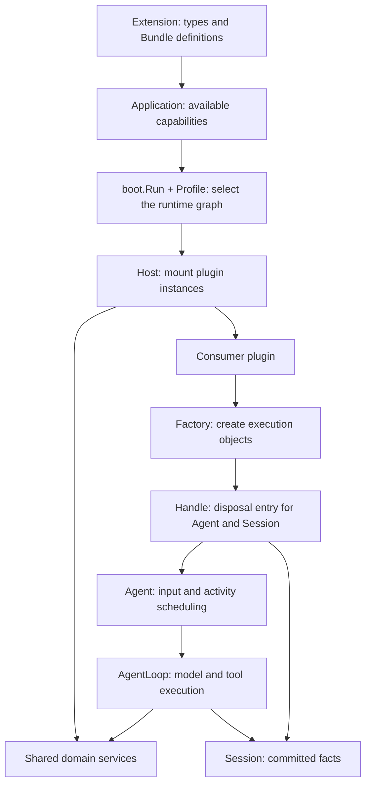

# Qi core concepts

English | [中文](concepts.zh.md)

This guide introduces kernel objects and their relationships. Read [Architecture](architecture.md) for execution and resource ownership, and [Building](building.md) for extension builds and delivery. To run an application first, follow [builtin getting started](../../builtin/docs/getting-started.md), then map these objects to configuration in [Builtin application concepts](../../builtin/docs/concepts.md).

## 1. From available capabilities to execution

A Qi application describes available capabilities, then uses a Profile to select plugin instances for a run. Plugins share one Host managed by the launcher. Consumer plugins use those services to create Agents, submit input and read results.

There are two levels: **plugin instances** are service providers or consumers selected by the Profile and mounted by the Host; **Agents** are execution objects created by consumers through Factory. One consumer can own several Handles. Each Handle exposes one Agent and its Session.

## 2. Select code, describe capabilities, mount instances

These concepts address code sources, capability descriptions and run configuration:

| Concept | Responsibility |
| --- | --- |
| Go module | Identified by `go.mod`; owns versions and dependencies and may contain multiple packages. |
| Go package | Supplies importable code; a selectable extension package exports `Extension()`. |
| Plugin type | Implementation template described by `Plugin.Spec()`; a Profile's `plugin` references its type ID, and `Spec.New` creates a fresh object for each generation. |
| Registration | Associates a plugin prototype with configuration rules, Profile visibility and invocation metadata. |
| Extension | Publishes Registrations and Bundle definitions; may contain multiple plugin types. |
| Application | Static capability catalog assembled from explicit Extensions by `application.Compose(...)`. |
| Bundle | Reusable instance declarations expanded when selected by a Profile. |
| Profile | Selects Bundles, declares instances and configures this run's graph. |
| Plugin instance | An actual object created and activated from a declaration; `id` names the instance, while `plugin` names its type. |

For example, `builtin/examples/tool-plugin` is a package in the `github.com/RussellLuo/qi/builtin` module and shares `builtin/go.mod` with the other examples. It publishes type `example/tool-plugin`, instantiated as `greet` in its Profile. Package paths, type IDs and instance IDs serve different purposes. See [the tool plugin example](../../builtin/examples/tool-plugin/README.md).

Ordinary Go dependencies and `--replace` only provide or substitute source; `qi-build --with` selects an extension factory. Factories and Compose describe capabilities without creating a Host or activating instances. `application.Compose` does not implicitly add builtin; qi-build explicitly includes builtin and the selected extensions in generated entries. Adding Go extensions requires rebuilding; a different Profile can change instance composition among published capabilities.

### Foundational services and the base Bundle

[kernel/bundle](../bundle/README.md) publishes six foundational types and the sole `base` definition:

| base instance ID | Plugin type | Responsibility |
| --- | --- | --- |
| `events` | `gordis/events` | Event bus. |
| `session` | `qi/session` | Session Runtime. |
| `llm-runtime` | `qi/llm` | Adapter routing, model selection and call preparation. |
| `prompt-runtime` | `qi/prompt` | Prompt contributions and assembly. |
| `tools` | `qi/tools` | Tool definitions, validation and execution. |
| `agent` | `qi/agent-loop` | Registry, Factory, Loop, initialization, observation and Agent middleware. |

Base contains no model provider, persistence provider or consumer. Compiling types does not mount them. Builtin reuses this foundational Extension and adds four concrete implementations; Profiles must still explicitly select base and other instances.

Bundles expand in Profile order, followed by user instances and `overrides`. Use overrides to change an existing instance: `config` replaces the whole configuration object, and changing `plugin` first clears old configuration. Disabled declarations still require published types. See the [Profile reference](profiles.md) for fields, override examples and common errors.

## 3. Host, Scope, generation and contributions

The **Host** manages the shared plugin graph; the launcher creates and closes it. Gordis owns service dependencies, mounting and Scopes, while Qi organizes domain services and Agent execution on top.

A **Scope** belongs to one **generation** of a plugin instance: one activation lifetime. Plugins declare services through `Requires` / `Provides`, obtain or publish them in `Activate`, and register stop and cleanup actions.

A **service** is a shared capability, such as the LLM Runtime identified by `llm.RuntimeKey`. A **contribution** is behavior registered into that service, such as a model Adapter, Prompt section, Tool definition or middleware. Contributors obtain a service and use `runtime.Bind(scope)` to bind contributions to their generation.

A **ContributionOwner** identifies the contribution owner. A **lease** retains that generation while an execution snapshot uses it. Withdrawal affects future selection; existing snapshots retain leases. See [Architecture](architecture.md) and [capability APIs](../core/README.md) for Scope Binding, lease drain and cleanup order.

## 4. Store, Session, log and projection

A **Store** is the Session service contract. **Session Runtime** manages open domain Session instances. **Persistence** owns physical histories and handles; an optional **PersistenceProvider** supplies independent resource leases. Without a persistence provider, new Sessions use memory and cannot Resume across processes.

A **Session** retains ordered `SessionEvent` facts. Logs and projections advance only after successful commit. `Watermark()` returns the last committed sequence, or `-1` for an empty log; `Events(ctx, after)` reads a current log snapshot after that sequence.

A **Projection** derives messages, request configuration, tool history and pending Inbox from the log. Its **Surface** selects the messages visible to the model. Replaced messages remain in the log, so model-visible messages do not replace complete audit history.

`Store.Get` queries open instances; `StoreOpener.Open` acquires existing history. Releasing runtime resources preserves history; Delete removes it. See [Architecture](architecture.md) and [Session APIs](../core/session/README.md) for transactions, exclusive attachment and recovery.

## 5. Agent, Registry, Factory and Handle

An **Agent** owns input scheduling, activity cancellation and idle waits. **Registry** reserves identities and queries published objects. **Factory** acquires Sessions, initializes Agents and publishes them. A **Handle** gives callers one disposal entry for those execution resources. **Loop/Driver** executes models, tools and log settlement.

| Factory operation | Purpose |
| --- | --- |
| Create | Create a new Session and Agent. |
| Attach | Create an Agent borrowing an open Session. |
| Resume | Open existing history and create an Agent; distinct from Registry queries or Store.Get. |
| Handle.Dispose | Stop and drain the Agent, release owned runtime resources and preserve persistent history and borrowed Sessions. |

Consumers declare `agent.FactoryKey.Spec()`, get the Provider with `scope.Get(agent.FactoryKey)` and call `provider.Bind(scope)`. Binding can happen during Activate; execution waits for whole-graph Ready. See [Architecture](architecture.md) and [Agent APIs](../core/agent/README.md) for creation, rollback and shutdown responsibilities.

## 6. Input, Turn, Step and attempt

An **activity** is a period of Agent work ending at idle and may process several **Turns**. A Turn is one input-processing round. A **Step** contains a model request and its tool processing; retries may produce several model **attempts** in one Step.

| Input API | Target queue | Wakes work? |
| --- | --- | --- |
| `Submit` | `next-turn` | Yes; returns InvocationID and a raw DriverEvent observation stream. |
| `Followup` | `next-turn` | Yes. |
| `Steer` | `next-step` | Yes. |
| `Inject` | `next-step` | No. |
| `Send` | Explicit target | Controlled by `wakeup`. |

Input enters the Inbox and is claimed by the Loop at turn or step boundaries. `Splice` edits pending input. These APIs cannot insert input into an executing model request. `WhenIdle` / `WaitIdle` wait for work to drain; committed Turn settlement still determines success. Ending observation or canceling a wait does not cancel activity; use `Cancel`, `CancelActivity` or owner stop.

## 7. Models, Prompt, Tool and middleware

An **llm.Adapter** returns canonical `StreamChunk` values through `Stream(ctx, request)`. Optional **ModelResolver** supplies validation and capability information; default resolution without it does not establish upstream model support. A **Route** is an Adapter registration key, **Provider/Model** is a call target, and a product model catalog supplies consumer-facing IDs and configuration. See [LLM APIs](../core/llm/README.md) for contributions and [Runtime](../core/llm/runtime.go) for calls and routing.

A **prompt.Section** contributes to an ordered Prompt. A **tools.Definition** describes a tool's name, schemas, callback and failure policy. Results distinguish application JSON `Value` from model-facing `Content`.

**Agent middleware** participates in steps, requests, streams, error retries and turn stopping. **Tool middleware** has Pre/Execute/Post stages. **PreparedRun** retains contribution snapshots for execution; **PreparedStep** binds specific model calls. Closing them releases leases. See [Architecture](architecture.md) for preparation, execution and cancellation settlement.

## 8. Committed facts and live observations

| Data | Purpose and guarantee |
| --- | --- |
| `SessionEvent` | Committed turn, message, tool, request and Inbox facts; durability depends on the backend. |
| `AssistantStreamFrame` | Live attempt deltas and final settlement; previews are provisional, and committed outcomes reference real Session seq values. |
| `DriverEvent` | Local execution observation, including errors that may not be committed. |
| Gordis Topics | Passive plugin observation through bounded queues; overload can drop notifications. |

Read reliable results from committed Session facts. Live observation does not own execution, and ending iteration does not cancel it. Use middleware to change behavior and observations for statistics or display. See [Architecture](architecture.md) for reliable backfill, stream gaps and observation callback lifetimes.
