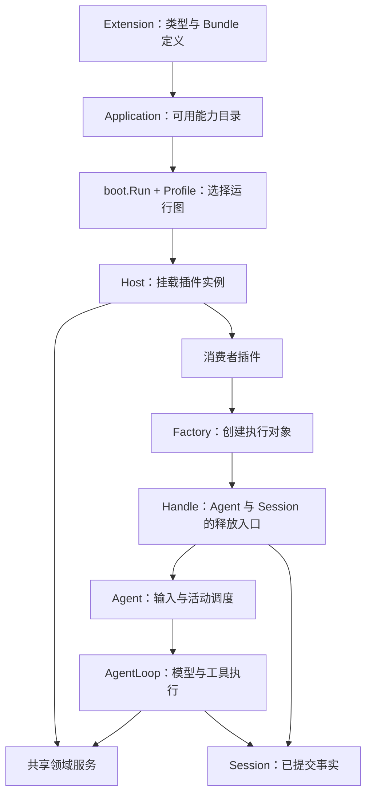

# Qi 核心概念

[English](concepts.md) | 中文

本文介绍 kernel 的核心对象及其关系。实现流程与资源所有权见[架构](architecture.zh.md)，扩展构建与交付见[构建指南](building.zh.md)。想先运行应用，可以从 [builtin 入门](../../builtin/docs/getting-started.zh.md)开始，再通过[内建应用概念](../../builtin/docs/concepts.zh.md)把这些对象对应到具体配置。

## 1. 从可用能力到一次执行

Qi 应用先描述有哪些能力可用，再通过 Profile 选择本次运行的插件实例。插件共享一个由 launcher 管理的 Host；消费者插件使用这些服务创建 Agent，提交输入并取得结果。

这里有两个层次：**插件实例**是 Profile 选择并由 Host 挂载的服务提供者或消费者；**Agent** 是消费者通过 Factory 创建的执行对象。一个消费者可以拥有多个 Handle，一个 Handle 对应一个 Agent 及其 Session。

## 2. 选择代码、描述能力、挂载实例

这些概念分别解决代码来源、能力描述和运行配置的问题：

| 概念 | 职责 |
| --- | --- |
| Go module | 由 `go.mod` 标识，管理版本和依赖；一个 module 可以包含多个包。 |
| Go package | 提供可导入代码；可选扩展包导出 `Extension()`。 |
| Plugin type | 通过 `Plugin.Spec()` 描述实现模板，类型 ID 供 Profile 的 `plugin` 引用；`Spec.New` 为每个 generation 创建新对象。 |
| Registration | 将插件原型、配置规则、Profile 可见性和调用元数据关联起来。 |
| Extension | 发布一组 Registration 和 Bundle 定义；可以包含多个插件类型。 |
| Application | `application.Compose(...)` 汇总显式 Extension 后得到的静态可用目录。 |
| Bundle | 可复用的插件实例声明，由 Profile 选择后展开。 |
| Profile | 选择 Bundle、声明实例并配置本次运行图。 |
| Plugin instance | 按声明创建和激活的实际对象；`id` 是实例名，`plugin` 是类型 ID。 |

例如，`builtin/examples/tool-plugin` 是 `github.com/RussellLuo/qi/builtin` module 内的一个包，与其他示例共享 `builtin/go.mod`；它发布 `example/tool-plugin` 类型，Profile 将该类型的实例命名为 `greet`。包路径、类型 ID 和实例 ID 各有用途，见[工具插件示例](../../builtin/examples/tool-plugin/README.zh.md)。

普通 Go 依赖和 `--replace` 只提供或替换源码；`qi-build --with` 才选择扩展工厂。工厂与 Compose 只描述能力，不创建 Host 或激活实例。`application.Compose` 不隐式加入 builtin；qi-build 生成入口会显式加入 builtin，再加入所选扩展。增加 Go 扩展需要重新构建；调整已公开能力的实例组合可以只更换 Profile。

### 基础服务与 base Bundle

[kernel/bundle](../bundle/README.zh.md) 发布六种基础类型与唯一的 `base` 定义：

| base 实例 ID | 插件类型 | 职责 |
| --- | --- | --- |
| `events` | `gordis/events` | 事件总线。 |
| `session` | `qi/session` | Session Runtime。 |
| `llm-runtime` | `qi/llm` | Adapter 路由、模型选择与调用准备。 |
| `prompt-runtime` | `qi/prompt` | Prompt 贡献与组装。 |
| `tools` | `qi/tools` | Tool 定义、校验与执行。 |
| `agent` | `qi/agent-loop` | Registry、Factory、Loop、初始化、观察与 Agent middleware。 |

base 不包含模型提供者、持久化提供者或消费者；编译了类型也不会自动挂载它们。builtin 复用此基础扩展，再加入四种具体实现；Profile 仍须显式选择 base 和其他实例。

Bundle 按 Profile 顺序展开，再应用用户实例和 `overrides`。修改已有实例使用 overrides；其中的 `config` 替换整个配置对象，切换 `plugin` 会先清空旧配置。disabled 声明的类型仍须在可用目录中。完整字段、覆盖示例和常见错误见 [Profile 配置参考](profiles.zh.md)。

## 3. Host、Scope、generation 与贡献

**Host** 管理共享插件图，由 launcher 创建和关闭。Gordis 负责服务依赖、挂载与 Scope，Qi 在其上组织领域服务与 Agent 执行。

**Scope** 属于一个插件实例的特定 **generation**，即该实例的一次激活周期。插件通过 `Requires` / `Provides` 声明服务，在 `Activate` 中取得或发布服务，并登记停止与清理动作。

**服务**是共享能力，例如 `llm.RuntimeKey` 标识的 LLM Runtime；**贡献**是注册到服务中的具体行为，例如模型 Adapter、Prompt section、Tool definition 或 middleware。贡献插件取得服务后使用 `runtime.Bind(scope)` 将贡献绑定到自己的 generation。

**ContributionOwner** 标识贡献的 owner；**lease** 让执行快照在使用期间保留该 generation。撤销注册影响后续选择，已有快照继续持有租约。Scope Binding、租约排空和清理顺序见[架构](architecture.zh.md)及[能力 API](../core/README.zh.md)。

## 4. Store、Session、日志与投影

**Store** 是 Session 服务契约；**Session Runtime** 管理已打开的领域 Session 实例。**Persistence** 管理物理历史和句柄，由可选的 **PersistenceProvider** 提供独立资源租约。没有持久化提供者时，新 Session 使用内存，不能跨进程 Resume。

**Session** 保存有序的 `SessionEvent`。日志与投影只在提交成功后推进。`Watermark()` 表示最后一个已提交序号，空日志为 `-1`；`Events(ctx, after)` 读取该序号之后的当前日志快照。

**Projection** 从日志推导消息、请求配置、工具历史和待处理 Inbox；**Surface** 决定哪些消息对模型可见。替换过的消息仍保留在日志中，因此模型消息视图不能替代完整审计历史。

`Store.Get` 只查询已打开实例，`StoreOpener.Open` 获取已有历史。释放运行资源保留历史，Delete 才删除历史。事务、独占 attachment 和恢复流程见[架构](architecture.zh.md)及 [Session API](../core/session/README.zh.md)。

## 5. Agent、Registry、Factory 与 Handle

**Agent** 负责输入调度、活动取消与空闲等待；**Registry** 负责身份预留和已发布对象查询；**Factory** 完成 Session 获取、初始化及 Agent 发布；**Handle** 是调用方统一释放这些执行资源的入口。**Loop/Driver** 执行模型、工具与日志结算。

| Factory 操作 | 用途 |
| --- | --- |
| Create | 新建 Session 和 Agent。 |
| Attach | 借用一个已打开的 Session 创建 Agent。 |
| Resume | 打开已有历史并创建 Agent；与 Registry 查询或 Store.Get 不同。 |
| Handle.Dispose | 停止并排空 Agent，释放拥有的运行资源，保留持久历史和借用的 Session。 |

消费者声明 `agent.FactoryKey.Spec()`，通过 `scope.Get(agent.FactoryKey)` 取得 Provider，再调用 `provider.Bind(scope)`。绑定可以在 Activate 中完成，执行须等待全图 Ready。创建、回滚和关闭的完整责任见[架构](architecture.zh.md)及 [Agent API](../core/agent/README.zh.md)。

## 6. 输入、Turn、Step 与 attempt

**activity** 是 Agent 开始工作到空闲的一段活动，可以处理多个 **Turn**。Turn 是一次输入处理轮次；**Step** 是轮次内的一次模型请求及其工具处理；重试可以在同一 Step 中产生多个模型 **attempt**。

| 输入 API | 目标队列 | 是否唤醒工作 |
| --- | --- | --- |
| `Submit` | `next-turn` | 是；返回 InvocationID 和原始 DriverEvent 观察流。 |
| `Followup` | `next-turn` | 是。 |
| `Steer` | `next-step` | 是。 |
| `Inject` | `next-step` | 否。 |
| `Send` | 显式目标 | 由 `wakeup` 决定。 |

输入先进入 Inbox，由 Loop 在轮次或步骤边界 claim；`Splice` 编辑待处理输入。这些 API 不会把输入插入正在执行的模型请求。`WhenIdle` / `WaitIdle` 等待工作排空，业务成功仍需检查已提交的 Turn 结算。停止观察或取消等待不会取消活动；活动取消使用 `Cancel`、`CancelActivity` 或 owner 停止。

## 7. 模型、Prompt、Tool 与 middleware

**llm.Adapter** 通过 `Stream(ctx, request)` 返回标准 `StreamChunk`。可选 `ModelResolver` 提供模型校验与能力信息；未实现时的默认解析不证明上游支持该模型。**Route** 是 Adapter 注册键，**Provider/Model** 是调用目标；产品模型目录则提供消费者使用的产品 ID 和配置。贡献 API 见 [LLM 说明](../core/llm/README.zh.md)，调用与路由实现见 [Runtime](../core/llm/runtime.go)。

**prompt.Section** 按顺序组装 Prompt；**tools.Definition** 描述工具名称、schema、执行回调与失败策略。工具结果区分程序使用的 JSON `Value` 和模型可见的 `Content`。

**Agent middleware** 干预步骤、请求、流、错误重试和轮次停止；**Tool middleware** 提供 Pre/Execute/Post。**PreparedRun** 固定执行使用的贡献快照，**PreparedStep** 绑定具体模型调用；关闭时释放租约。准备、执行和取消结算流程见[架构](architecture.zh.md)。

## 8. 已提交事实与实时观察

| 数据 | 用途与保证 |
| --- | --- |
| `SessionEvent` | 已提交的轮次、消息、工具、请求与 Inbox 事实；持久性取决于后端。 |
| `AssistantStreamFrame` | attempt 实时增量与最终 settlement；预览尚未提交，committed 引用真实 Session seq。 |
| `DriverEvent` | 本地执行观察，可以报告尚未提交的错误。 |
| Gordis Topics | 面向插件的被动观察；队列有界，过载时可能丢通知。 |

可靠结果从 Session 已提交事实读取。实时观察不拥有执行生命周期，结束读取不等于取消。改变执行行为使用 middleware，统计或展示使用观察；可靠补读、流缺口处理和观察回调的生命周期见[架构](architecture.zh.md)。
